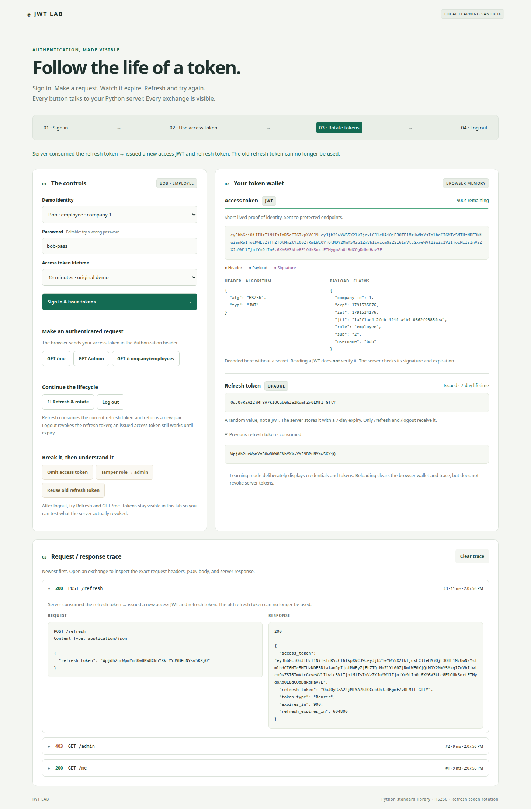

# JWT Playground

See how JWT authentication works in your browser: inspect access and refresh tokens, watch expiry, rotate tokens, and explore failed requests. Built with Python's standard library and plain HTML, CSS, and JavaScript.



## Run it

Requires Python 3.10+ and a modern browser. No packages, database, or frontend build required.

```bash
git clone https://github.com/prashant676a/jwt_demo.git
cd jwt_demo
python3 server.py
```

Open **http://127.0.0.1:8000** in your browser. No frontend installation or build is needed.

### Follow the flow in the browser

1. Sign in as Bob with the default **20-second** access token lifetime. See the raw access JWT, decoded header and claims, and opaque refresh token in the wallet.
2. Click **GET /me** to authenticate, **GET /admin** to see Bob's `403`, and **GET /company/employees** to see his company. Sign in as Alice for admin access, or Carol for a different company.
3. Let the countdown reach zero and click **GET /me** again: the server returns `401 token expired`.
4. Click **Refresh & rotate**. Both tokens change; **GET /me** works again. **Reuse old refresh token** shows that the consumed token is rejected.
5. Try **Omit access token** and **Tamper role → admin** to see authentication and signature failures.
6. Click **Log out**, then try **Refresh** (rejected) and **GET /me** (still works until access-token expiry).

Every exchange appears in the request/response trace with the application request headers, JSON body, HTTP status, and response. The UI deliberately keeps tokens visible after logout for experimentation. Tokens and trace are only held in page memory; reloading clears the page but does not revoke server tokens. The refresh-token store is in server memory and resets when Python restarts.

The browser defaults to a 20-second access token so expiry is easy to observe. Select 15 minutes for the original lifetime. API clients omitting `access_ttl` still get 15 minutes; refresh preserves the selected lifetime. Refresh tokens last 7 days. This is a local teaching demo that displays tokens and credentials, not a production authentication template.

Run `python3 -m unittest test_server.py` to check the browser assets and lifecycle API contract.

```bash
python3 test_jwt_core.py          # 10 token unit tests
python3 demo.py                   # 21 end-to-end API scenarios
python3 -m unittest test_server.py # 3 browser/API contract tests
```

To use another port, run `python3 server.py 8001` and open `http://127.0.0.1:8001`.

Users: `alice/alice-pass` (admin, company 1), `bob/bob-pass` (employee, company 1), `carol/carol-pass` (employee, company 2).

```
curl -s -X POST localhost:8000/login -d '{"username":"bob","password":"bob-pass"}'
curl -s localhost:8000/me -H "Authorization: Bearer <access_token>"
curl -s localhost:8000/admin -H "Authorization: Bearer <access_token>"      # 403 for bob
curl -s localhost:8000/company/employees -H "Authorization: Bearer <access_token>"
curl -s -X POST localhost:8000/refresh -d '{"refresh_token":"<refresh_token>"}'
```

## Files

| File | What it teaches |
|---|---|
| `jwt_core.py` | The token itself: base64url, HMAC-SHA256 signature, expiry check, the `alg: none` defense, constant-time compare |
| `server.py` | Login with salted PBKDF2 passwords, Bearer auth, 401 vs 403, tenant scoping from `company_id`, refresh-token rotation, logout |
| `static/` | Browser controls, live token wallet, decoded claims, expiry countdown, and request/response trace |
| `demo.py` | Every attack and edge case run end to end against the server |
| `test_jwt_core.py` | The same ideas as small unit tests |

## The five ideas to be able to say aloud

1. A JWT is `header.payload.signature`, each part base64url encoded. The payload is **readable by anyone**; the signature only proves it was not changed.
2. HS256 signs with one shared secret (HMAC). RS256 signs with a private key and verifies with a public key, which is better when other services verify tokens (Cognito uses RS256).
3. Require the expected algorithm, verify the signature, and check `exp`. Never let an untrusted `alg` header choose how verification works (the `none` attack).
4. Access tokens are short-lived so a stolen one expires fast. Refresh tokens are long-lived, stored server side, and rotated on use. This lab rejects consumed tokens; revoking an entire token family after reuse is left as an exercise.
5. 401 means "I don't know who you are". 403 means "I know who you are, and you may not do this".

## Exercises (do them in this order)

1. Add an `aud` (audience) claim and reject tokens meant for another audience.
2. Revoke an access token on logout: keep a set of revoked `jti` values until they expire. Notice you gave up some statelessness.
3. Refresh-token reuse detection: if a rotated refresh token is presented again, revoke every refresh token for that user.
4. Make `/admin` load the role from `USERS` instead of the token. Change a role and compare the behavior.
5. Rate-limit `/login` by username.
6. Optional: switch to RS256 using the `cryptography` package.
